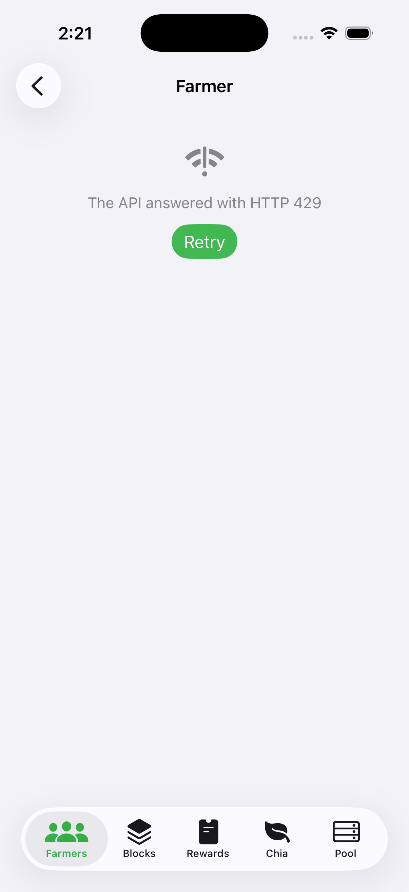
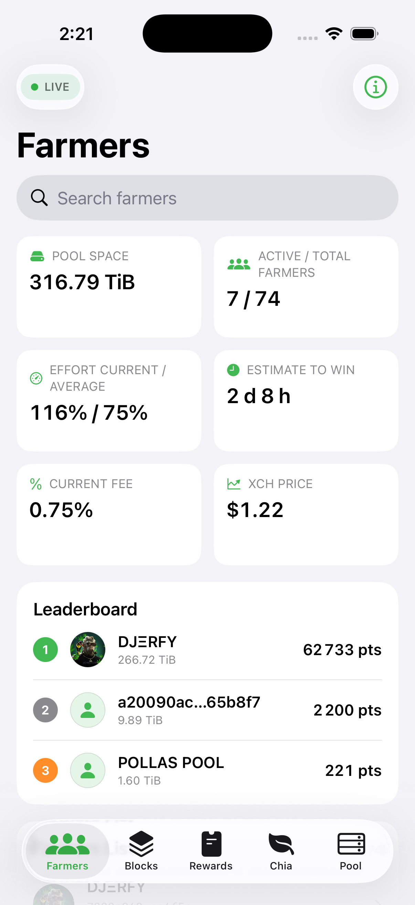
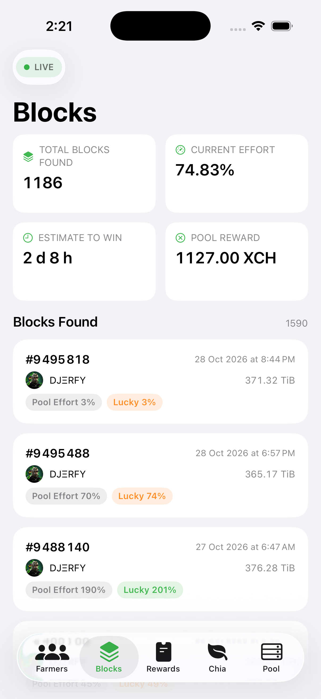
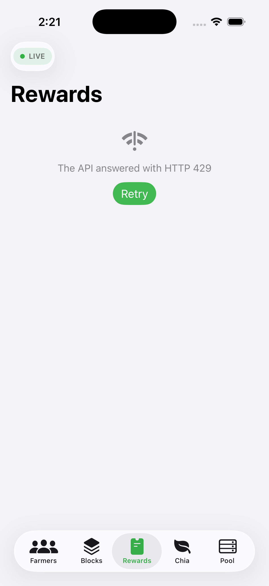
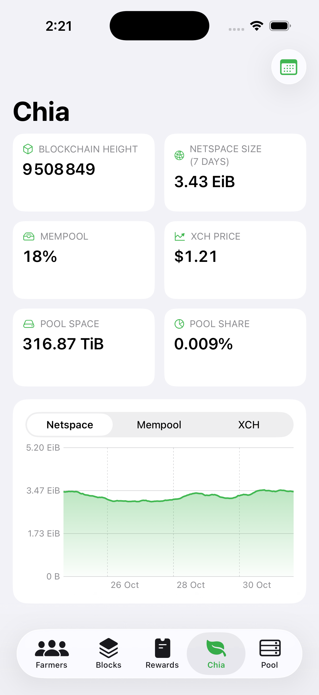
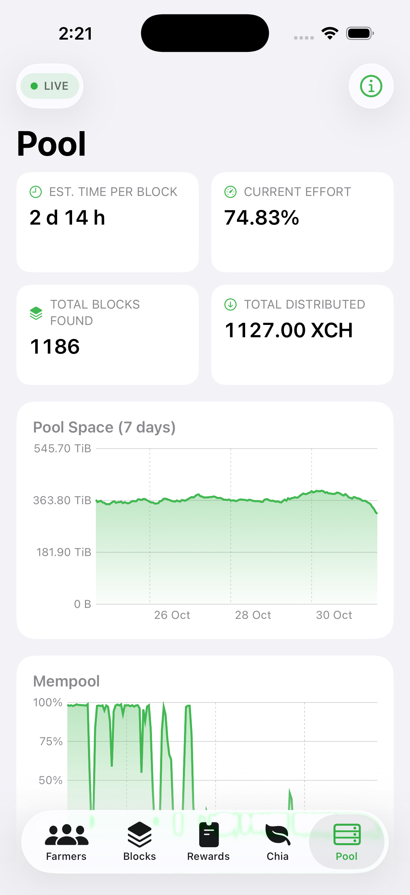

# Pool.Energy — iOS

[](https://developer.apple.com/ios/)
[](https://swift.org)
[](https://developer.apple.com/xcode/swiftui/)
[](LICENSE)

A native **SwiftUI** client for the [Pool.Energy](https://pool.energy) public
API — the Chia farming pool dashboard, rebuilt for iPhone with live WebSocket
updates, native charts and seven languages.

<p align="center">
  
</p>

| Farmers | Farmer detail | Blocks |
| --- | --- | --- |
|  |  |  |

| Rewards | Chia | Pool |
| --- | --- | --- |
|  |  |  |

> Screenshots captured from the iOS 26.3 simulator against the production API.

---

## Table of contents

- [Features](#features)
- [Tech stack](#tech-stack)
- [Getting started](#getting-started)
- [Project structure](#project-structure)
- [Architecture](#architecture)
- [API surface](#api-surface)
- [Localization](#localization)
- [Screenshots and launch arguments](#screenshots-and-launch-arguments)
- [Roadmap and limitations](#roadmap-and-limitations)
- [License](#license)

## Features

| Screen | What it shows |
| --- | --- |
| **Farmers** | Pool space, active/total farmers, effort, estimate to win, fee and XCH price; top-3 leaderboard; searchable, infinitely scrolling farmers list with points, size and difficulty. Live updates. |
| **Farmer** | Launcher header (avatar, id, online state, size, utilisation), five KPIs, 7-day estimated size chart and tabs for overview, partials, harvesters, blocks and rewards. Live updates. |
| **Blocks** | Pool totals, latest farmed blocks with farmer, pool space, effort and luck. Live updates. |
| **Rewards** | Payout list with amounts and fees, plus a detail sheet listing every payout address and its confirmation state. Live updates. |
| **Chia** | Blockchain height, netspace, mempool, XCH price, pool space and pool share, with switchable netspace/mempool/price charts and a 1/7/30-day range. |
| **Pool** | Estimate per block, current effort, total blocks, distributed rewards, 7-day pool size chart, mempool chart and wallet/node sync status. Live updates. |
| **About** | Version, website/API/social links, language picker (7 languages) and USD/EUR currency switch. |

Everything is read-only: the app consumes the public API without credentials.

## Tech stack

| Concern | Choice |
| --- | --- |
| UI | SwiftUI, iOS 17+, `@Observable` view models, no third-party UI libraries |
| Charts | Swift Charts (`AreaMark`/`LineMark`) replacing ApexCharts |
| Networking | `URLSession` with `async/await`, `Codable`, request coalescing and a 5 s response cache |
| Live data | `URLSessionWebSocketTask` with automatic reconnection |
| State | Observation framework (`@State`, `@Environment`, `@Observable`) |
| Localization | Bundled JSON dictionaries shared with the web app |
| Project | XcodeGen (`project.yml`), Swift 5 language mode, Swift 6.2 toolchain |
| License | AGPL-3.0 |

## Getting started

### Requirements

- **Xcode 26+** (built with Xcode 26.3 / Swift 6.2)
- **iOS 17.0+** deployment target (iOS 26 recommended for the latest tab bar)
- [XcodeGen](https://github.com/yonaskolb/XcodeGen): `brew install xcodegen`

### Open the project

The `.xcodeproj` is generated and not committed:

```bash
brew install xcodegen
xcodegen generate
open PoolEnergy.xcodeproj
```

Then select your team in *Signing & Capabilities* — the bundle identifier is
`energy.pool.app`, change it if it collides with another team.

### Build from the command line

```bash
xcodebuild -project PoolEnergy.xcodeproj -scheme PoolEnergy \
  -sdk iphonesimulator -destination 'platform=iOS Simulator,name=iPhone 17 Pro' \
  CODE_SIGNING_ALLOWED=NO build
```

### Run on a simulator

```bash
xcrun simctl boot "iPhone 17 Pro"
xcrun simctl install booted build/Build/Products/Debug-iphonesimulator/PoolEnergy.app
xcrun simctl launch booted energy.pool.app
```

## Project structure

```
ios/
├── docs/screenshots/               # README screenshots
├── PoolEnergy/
│   ├── App/                        # Entry point + root tab bar
│   ├── Core/                       # APIClient, LiveSocket, Localization, formatting
│   ├── Models/                     # Codable models mirroring the DRF serializers
│   ├── Views/                      # Shared components (KPIs, cards, charts)
│   ├── Features/
│   │   ├── Farmers/                # List, leaderboard, search, pagination
│   │   ├── Farmer/                 # Detail + tabs
│   │   ├── Blocks/                 # Blocks feed
│   │   ├── Rewards/                # Payouts + payout detail
│   │   ├── Chia/                   # Blockchain metrics and charts
│   │   ├── Pool/                   # Pool status, wallets, nodes
│   │   └── Info/                   # About, language, currency
│   └── Resources/                  # Assets, app icon, i18n JSON
├── project.yml                     # XcodeGen definition
└── README.md
```

## Architecture

### Data flow

Each feature owns a `@MainActor @Observable` view model that fetches what its
screen needs and exposes immutable snapshots. Views stay declarative: they never
call the network directly.

`APIClient` (`Core/APIClient.swift`) is a small value type around `URLSession`
that appends paths to `https://pool.energy/api/v1.0/`, adds query items, decodes
with `convertFromSnakeCase` and maps failures to `APIError` (`http`, `transport`,
`decoding`).

To avoid tripping the public API's edge protection, every request goes through
two actors:

- `RequestGate` serialises outgoing calls. The edge answers `429` as soon as two
  requests are in flight from the same client, so the app never sends parallel
  bursts (the `async let` fan-out of each screen is queued instead).
- `ResponseCache` coalesces identical calls and keeps responses for five
  seconds, so tab switches and live refreshes reuse the same payload.

`429` responses are additionally retried up to four times honouring
`Retry-After` (capped at 10 s) before surfacing a friendly message.

`LiveSocket` (`Core/LiveSocket.swift`) wraps `URLSessionWebSocketTask`: it
connects to `wss://pool.energy/ws/<channel>/`, yields a signal for every frame
and reconnects after four seconds. Because the dashboard only needs to know
*that* something changed, view models throttle live refreshes (8–15 s) and
reload their endpoints instead of decoding the payload.

### Models

`Models/Models.swift` mirrors the DRF serializers: `Stats`, `Launcher`,
`LauncherDetail` (with `PayoutSummary`, `FeeDetails`, `PartialsSummary`,
`RewardsSummary`), `Block`, `Partial`, `Harvester`, `Payout`, `PayoutAddress`,
`TimeseriesPoint` and `GlobalMessage`. Ordering, pagination (`Page<Item>`) and
optional fields follow the API quirks, for example:

- `share_pplns` is a decimal **string**;
- `block.payout` is a hyperlink **string**, not an id;
- InfluxDB timeseries carry a `field` that may be a string or an int;
- `/launcher_size/` and `/pool_size/` return several series with duplicate
  timestamps, so the views filter on the field they need.

### Formatting

`Fmt` renders binary sizes (KiB→EiB), humanised durations (two largest units),
XCH from mojos, percentages, hashes and dates. `TimeseriesPoint` parses ISO
dates with and without fractional seconds, including the naive timestamps
returned by `/stats`.

`EmojiSupport` probes the system emoji font once: some simulator runtimes ship
without it, in which case emoji are stripped from farmer names instead of
rendering as tofu boxes.

### Charts

The pool API returns netspace in **MiB**, pool size twice (`chia.pool.energy`
and `global`) and XCH price in several currencies. `ChiaView` and `PoolView`
normalise these before plotting (`× 1024²` for netspace, `field == "global"` for
pool size, currency-based filter for prices).

## API surface

All calls target `https://pool.energy/api/v1.0/`:

| Endpoint | Used by |
| --- | --- |
| `/stats` | Farmers, Blocks, Chia, Pool |
| `/launcher/?is_pool_member=true&ordering=-points_pplns&limit=&offset=&search=` | Farmers |
| `/launcher/{launcher_id}/` | Farmer |
| `/launcher_size/?launcher=&days=7` | Farmer |
| `/partial/?launcher=&limit=&offset=` | Farmer |
| `/harvester/?launcher=&limit=` | Farmer |
| `/block/?limit=&offset=` and `/block/?farmed_by=` | Blocks, Farmer |
| `/payout/?launcher=&limit=&offset=` | Rewards, Farmer |
| `/payoutaddress/?payout=&limit=` | Payout detail |
| `/pool_size/?days=7` | Pool |
| `/stats/netspace/?days=` | Chia, Pool |
| `/stats/mempool/?days=` | Chia, Pool |
| `/stats/xchprice/?days=` | Chia |

WebSocket channels: `farmers`, `blocks`, `rewards`, `pool_status`,
`farmer/{launcher_id}`.

## Localization

The app bundles the same seven dictionaries as the web dashboard
(`en`, `fr`, `de`, `es`, `nl`, `tr`, `zh`, copied from
`web/src/assets/i18n`). `Localization` loads them at launch, resolves
namespaced keys (`FARMERS.STATS.POOL_SPACE`) against the current language with
an English fallback, defaults to the system language and persists the user's
choice in `UserDefaults`.

Because the keys are shared with the website, new translation strings should be
added to the web repository first, then copied here.

## Screenshots and launch arguments

The app reads two launch arguments, which makes screenshots and UI tests
reproducible without tapping:

```bash
# Open a given tab: farmers, blocks, rewards, chia or pool
xcrun simctl launch booted energy.pool.app -startTab chia

# Push a farmer detail screen at launch
xcrun simctl launch booted energy.pool.app -startTab farmers -startFarmer <launcher_id>
```

Screenshots are then captured with `xcrun simctl io booted screenshot`.

## Roadmap and limitations

- **Read-only**: launcher login (BLS signature), settings updates, QR login and
  push notifications are not implemented. iOS push would require an APNs token
  field and sender on the API side (the schema currently stores an FCM token).
- **Not shipped**: pool logs terminal, CSV export, partials feed, FAQ/team/fee
  pages.
- **App Store**: the Pool.Energy services are AGPL-3.0, which historically
  conflicts with App Store distribution terms. Decide between TestFlight/GitHub
  distribution or a separate licence before publishing.
- No unit or UI test target yet; the launch arguments are the first step toward
  deterministic UI tests.

## License

Distributed under the **GNU Affero General Public License v3.0** — see
[LICENSE](LICENSE).
